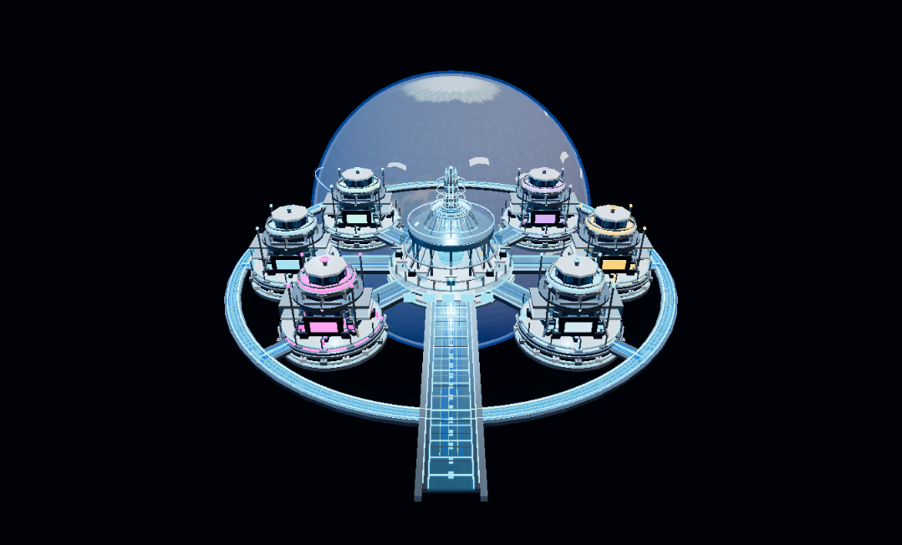
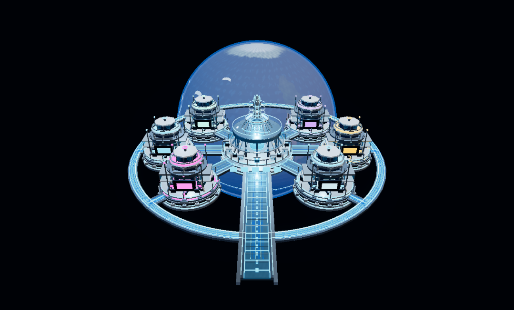
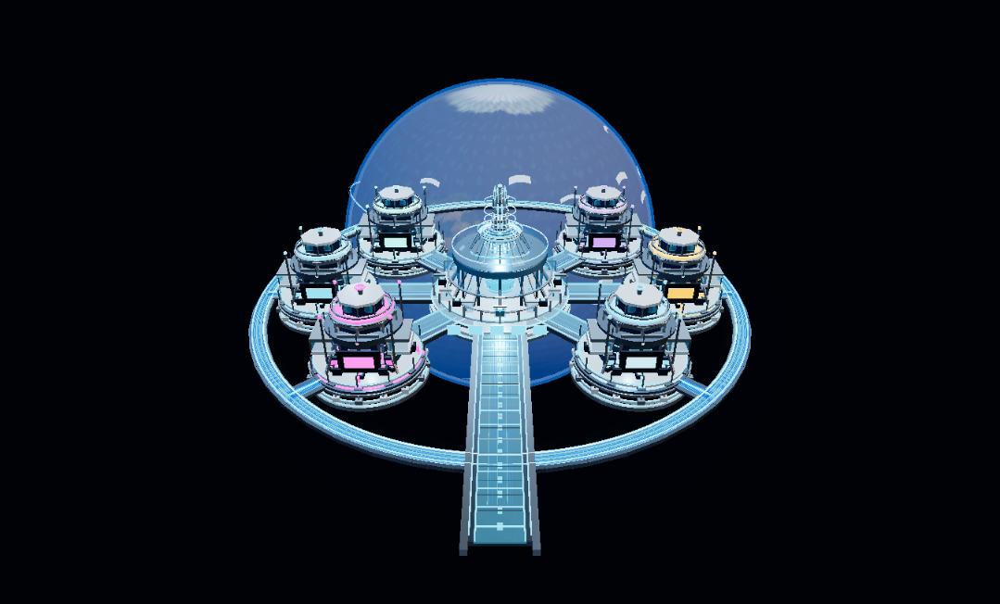

# Report B — Phase 4 visual refinement

## Scope and preserved assets

The approved GLB remains unchanged: SHA-256 `a64b5e8c90c42132cd3a12c9fa29d21d5803e64890443cfb8bf7ff1645961cf6`. The viewer still loads 3,076 meshes and all 118 animation clips. Earth geometry/rotation, station identities, camera controls, connectors, and dashboard code were not replaced.

The current default view remains the baseline. The two visual presets are runtime-only and exposed in the diagnostics panel when the viewer is opened with `?renderStats=1`.

## Before and after

The screenshots use the same viewport and command camera. The after image uses the reversible Earth/lighting/metal preset. The geographic image remains the embedded GLB texture; no external texture was introduced.

The Earth/lighting/metal preset slightly darkens the over-bright Earth surface, reduces cloud opacity, increases the blue scattering-shell opacity, moderates exposure/environment intensity, and makes cloned structural materials slightly rougher and more metallic. The Earth still reads as a stylized, flat blue sphere at the default camera because the land texture is low-detail and much of the globe is occluded by the station. A realistic Earth texture remains a Blender/asset decision requiring licensing review and approval.

The standard-glass candidate clones only materials with `KHR_materials_transmission`, sets transmission to zero, and uses ordinary alpha blending. The test scene shows reduced glass/ring readability, so this remains an experiment and is not recommended as the default.

## Reflection correction

The procedural PMREM was calling `fromScene` with `sigmaRadians=0.06`, which triggered Three.js warnings that the blur requested 30 samples while the implementation caps at 20. The default was reduced to `0.04`, which stays within the sampling limit. The PMREM is still created once at startup; no per-frame pass or external HDR asset was added. The prior environment and intensity are restored on disposal.

## Draw and GPU observations

Chrome reported WebGL 2 and `ANGLE (NVIDIA GeForce RTX 3070 Laptop GPU)`, with pixel ratio 1.25. Representative renderer counts:

| Runtime selection | Scene/shadow draws | Model draws (transmission subset) | Triangles | Post draws | Geometries / textures |
|---|---:|---:|---:|---:|---:|
| Baseline | 6,236 | 6,076 (2,977) | 917,502 | 14 | 3,134 / 20 |
| Earth / lighting / metal | 6,236 | 6,076 (2,977) | 917,502 | 14 | 3,134 / 20 |
| Standard glass | 3,259 | 3,099 (0) | 517,958 | 14 | 3,134 / 20 |

The glass variant removes 2,977 transmission-target submissions (47.7% of baseline scene submissions) and 399,544 triangle submissions (43.5%). In the automated browser run, GPU timer-query summaries were 30.01 ms average (baseline), 28.37 ms (Earth/lighting/metal), and 18.63 ms (standard glass). These are exploratory readings only: the browser automation host delivered about one animation frame per second, so measured FPS, frame percentiles, and the GPU comparison are not a controlled real-time benchmark. The 1% low values are invalid for hardware performance conclusions. No stable 60 FPS result is claimed.

The diagnostics now collect average/median/P95 CPU render-submission time separately from inter-frame timing and GPU timer-query values. Benchmark buttons refuse to start unless the tab is visible and focused. A foreground run on the user's desktop is still required to establish reproducible FPS and 1% low performance.

## Validation

- Full `npm test`: 53 passed, including GLB checksum/structure, fixture polling, PBR lifecycle/reversibility, renderer counter separation, benchmark foreground checks, and PMREM cleanup/blur tests.
- Chrome loaded the local viewer with the GLB and all animations; no JavaScript console errors appeared after the PMREM adjustment. The former PMREM clipping warnings were absent.
- Repeated material experiment switches returned the renderer counts to baseline; the diagnostics continued to report 3,134 geometries and 20 textures. Material-clone disposal and original material restoration are covered by tests.
- Explore Mode was preserved in source. Station identifiers and scene mappings are covered by the existing regression tests.
- Pixel ratio default remains 1.25. No external texture, GLB edit, new render pass, backend, connector, security, workflow, or deployment change was made.

## Recommendations for Phase 4.5

1. Replace the stylized Earth map only after selecting a properly licensed, higher-resolution albedo texture and a complementary normal/specular/night-light set; then bake/pack the maps into the Blender GLB.
2. Keep transmission on visually important outer-ring and optical surfaces. In Blender, identify low-visibility glass instances and prepare an authored non-transmission material variant for review.
3. Capture a focused 30-second-per-mode benchmark on the RTX 3070 with a fixed viewport and camera before changing default pixel ratio or shipping a glass substitution.
