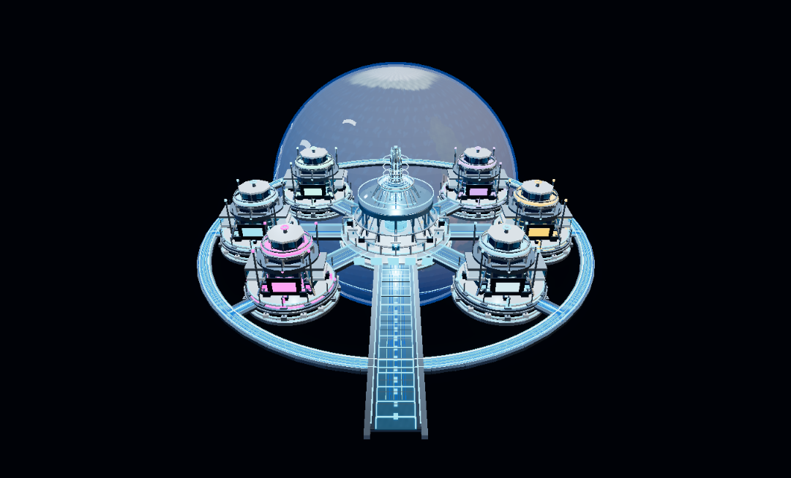
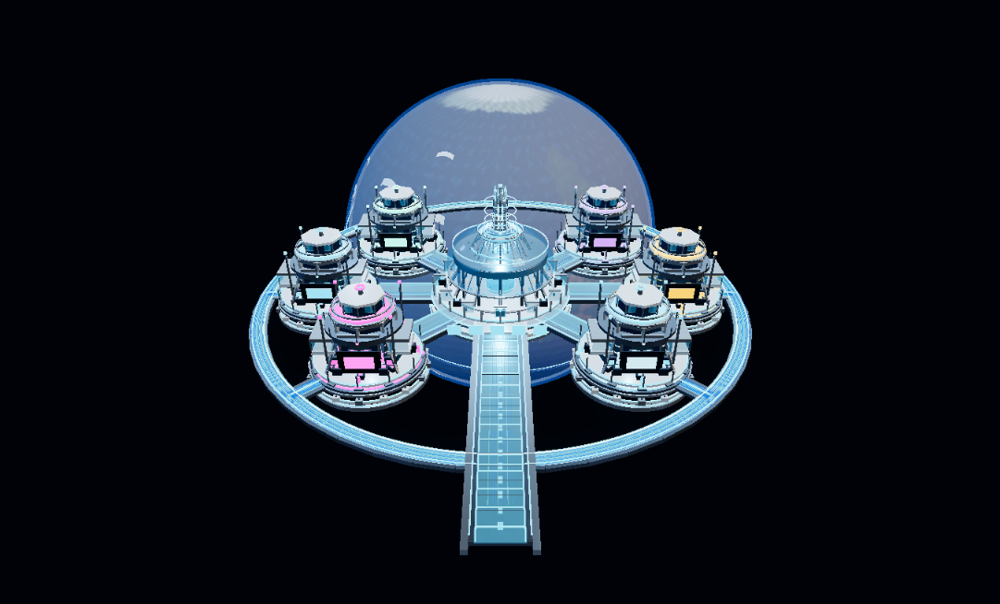
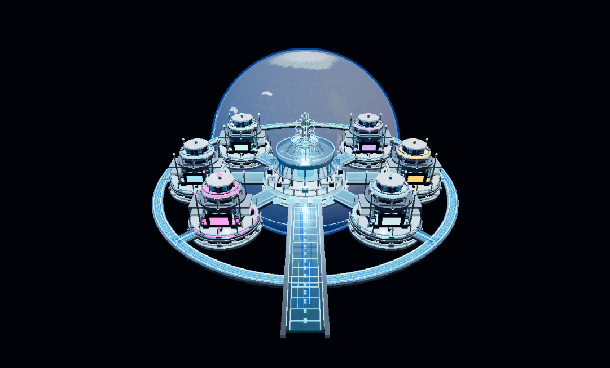
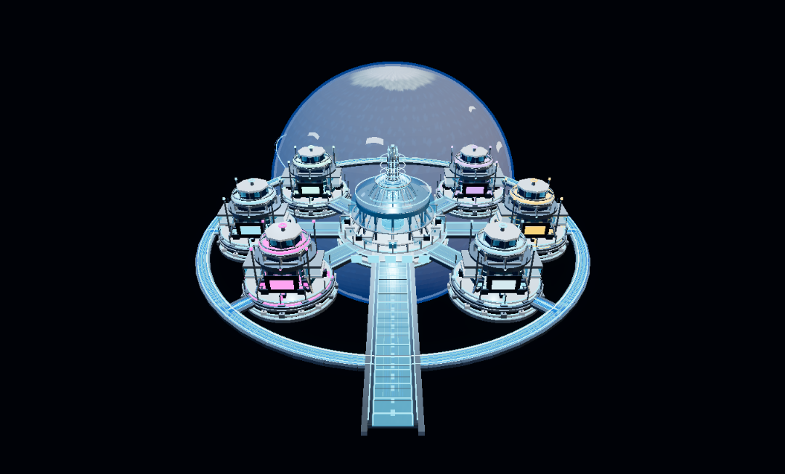

# Phase 4C — Hybrid Glass Optimization

## Scope and integrity

Work was performed on `feature/v88-8-chatgpt-readonly`. The approved GLB was not modified. Its SHA-256 before and after the work is `a64b5e8c90c42132cd3a12c9fa29d21d5803e64890443cfb8bf7ff1645961cf6`; the scene still loads 3,076 meshes and 118 animation clips. Material variants are runtime clones and switching back to baseline restores the original material references.

## Transmission cause and glass inventory

Three.js creates an opaque-scene transmission target when physical materials have `transmission > 0`. The target pass redraws the opaque scene; its submissions are included inside the scene count shown below, not additional to that count. Bloom/output postprocessing is measured separately and contributes 14 submissions here. Baseline is 6,236 scene/shadow draws: 6,076 model, 160 viewer, 0 shadow, with 2,977 transmission-target model submissions. Postprocessing adds 14 draws.

The GLB uses two transmission materials across 118 mesh instances:

| Material | Transmission factor | Instances | Main roles |
|---|---:|---:|---|
| `R13_glass_blue` | 0.78 | 117 | Six station bridge floors and tower-window sets; station observation glass; hero/hub glass; twelve `R17_RENDER_outer_glass_panel_*` pieces |
| `V7_optical_cyan_glass` | 0.32 | 1 | `R13_RENDER_translucent_command_dome` |

The 12 `R17_RENDER_outer_glass_panel_*` nodes are named “outer” but their GLB world-space centers are at radius 4.37, around the central Render hub. They are not the perimeter. The 21 transmissive mesh instances at radius ≥13 are the outlying tower/observation glass pieces. The main blue perimeter remains a separate visible path in the viewer scene. The selective experiment therefore uses world-space radius, not names, to target perimeter glass.

## Experiments and renderer measurements

Pixel ratio was 1.25 in the local browser. Scene counts, geometry/texture counts, and asynchronous GPU timer observations were available. The browser tab was visible but `document.hasFocus()` was false and its idle animation delivery was about 1 FPS. The benchmark control correctly refuses to run without foreground focus, so this session did **not** produce valid 30-second FPS, frame-time percentile, or average-GPU benchmarks. Do not compare its sporadic FPS/timer samples with a foreground RTX 3070 run.

| Mode | Scene/shadow draws | Model draws (transmission subset) | Triangles | Post draws | Geometries / textures |
|---|---:|---:|---:|---:|---:|
| Phase 4 baseline | 6,236 | 6,076 (2,977) | 917,502 | 14 | 3,134 / 20 |
| A — Selective transmission on perimeter glass | 6,139 | 5,979 (2,880) | 914,062 | 14 | 3,134 / 20 |
| B — Optimized non-transmissive glass | 3,259 | 3,099 (0) | 517,958 | 14 | 3,134 / 20 |
| C — Non-transmissive glass with perimeter accent | 3,259 | 3,099 (0) | 517,958 | 14 | 3,134 / 20 |

Mode A removes 97 transmission-target submissions (3.3%) and retains 96.7% of the baseline transmission work. That is not a meaningful proportional cost reduction: the renderer still captures nearly the same opaque scene. It also did not preserve the perimeter’s visible blue path as well as mode B in the matched default view.

Mode B removes all 2,977 transmission-target submissions and 399,544 triangles (43.5% of baseline scene triangles). It uses cloned standard PBR glass with transmission disabled, alpha transparency, depth writes off, modestly increased roughness/metalness, and a small emissive boost while retaining the source cyan tint. It had the clearest visual/performance trade-off in the available evidence.

Mode C applies a stronger cloned material adjustment to the existing outer-radius glass only. It has the same renderer counts as B, but the default view loses perimeter-path continuity/readability. It is preserved as a reversible experiment, not recommended for selection.

For context only, the supplied Phase 4 Windows foreground measurements report 40.7 average FPS baseline and 61.3 FPS for the earlier standard-glass preset at ratio 1.25. Those are not Phase 4C candidate measurements. Mode B is a different material recipe, so the earlier 61.3 FPS result cannot be assigned to it.

## Matched-view screenshots

The images use the default command camera and the same viewport. Embedded station animation continues between captures, so animation phase is not frame-identical.

| Baseline | B — Optimized non-transmissive glass |
|---|---|
|  |  |

| A — Selective perimeter transmission | C — Perimeter accent |
|---|---|
|  |  |

Earth appearance, station shapes, and metallic detail remain recognizable in B; no texture or geometry is substituted. The baseline and B screenshots retain the bright blue perimeter. A leaves almost all transmission cost active. C dims the perimeter in this view and fails the ring-readability criterion.

## Recommendation and limitations

Keep the existing baseline as the default for now. Recommend **B as the Phase 4C candidate for a focused foreground Windows benchmark and design review**, because it removes the transmission pass and its captured view retains the perimeter path. Do not make it the permanent default until a controlled 30-second run on the RTX 3070 confirms frame-time/FPS behavior and a camera-orbit/zoom review confirms the glass remains readable.

This browser session established draw-count changes, not sustained performance. It did not provide validated 60+ FPS, median FPS, 1% lows, or average CPU/GPU measurements for A/B/C. The captures use one default angle; camera orbit and zoom were not exhaustively reviewed. Material appearance can differ with viewport, lighting, and sorting.

## Validation and browser check

- `npm.cmd test`: 53 passed, 0 failed.
- `node scripts/test-physical-look.mjs`: passed. Regression checks cover source-material immutability, perimeter selection by world radius, mode switching/restoration, and preservation of glass mesh geometry.
- Viewer loaded through local fixture mode with all 3,076 meshes and 118 clips. Correct-route load showed no console errors, no console warnings, and no `/api/` requests/fixture polling regression. A prior exploratory navigation to a nonexistent nested viewer path returned 404; that was not the validation URL.
- Explore Mode controls, station animations, Monitor Mode, fixture polling guard, and other Phase 4 options were not altered.

## Next steps

1. On the actual Windows Chrome desktop, open `http://localhost:10000/viewer/v70.html?fixture=1&renderStats=1`, keep the tab foregrounded, and run the diagnostics button **Benchmark Phase 4 / 4C modes (30s each)** at ratio 1.25. Save/export the JSON and record the renderer/GPU shown by the panel.
2. Review B at the same station-focused angles in Command and Explore Mode, including orbit and zoom, before choosing it as the runtime default.
3. For Phase 4.5, author a Blender glass variant that preserves the approved perimeter appearance without relying on Three.js transmission; compare it against B before any asset change. Do not modify or replace the approved GLB during Phase 4C.
